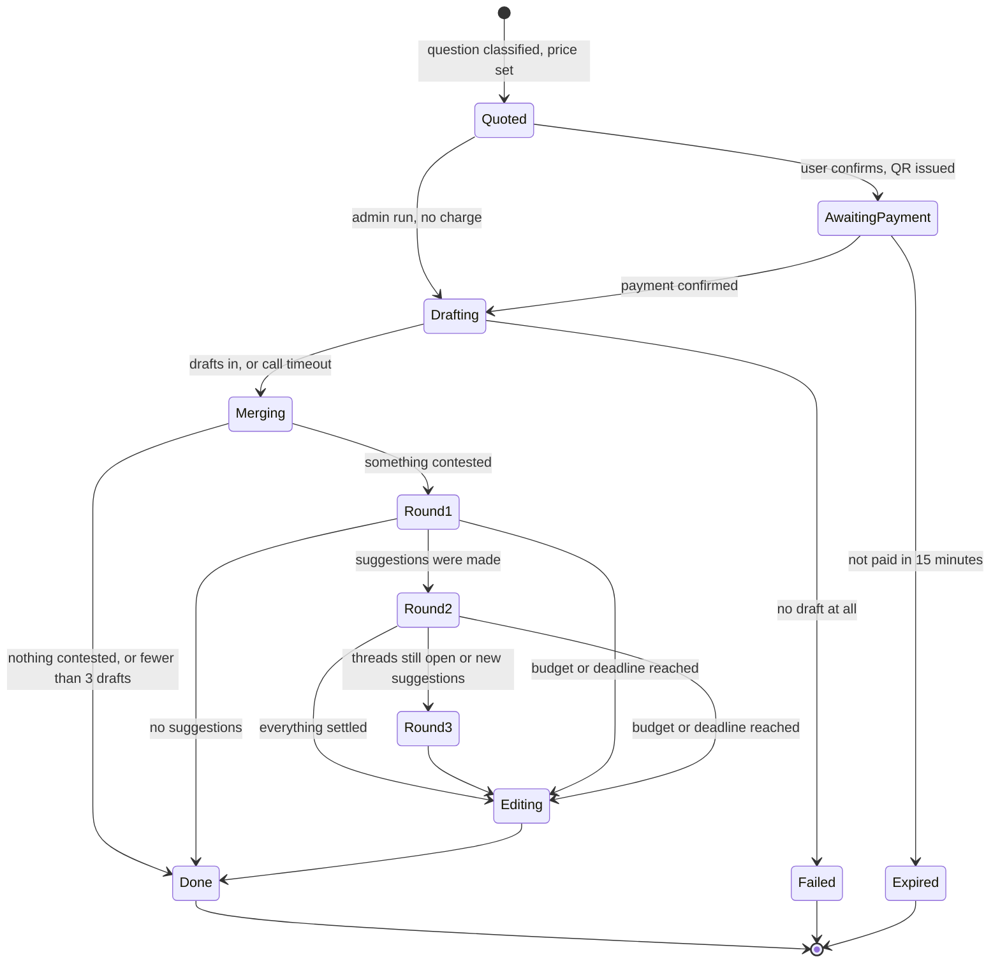
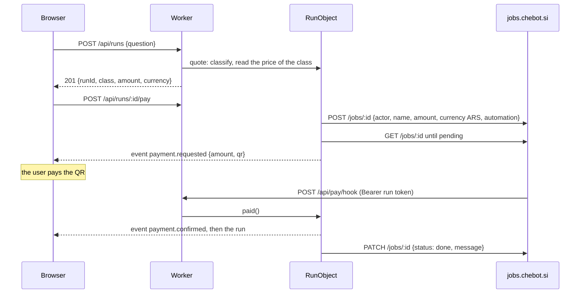
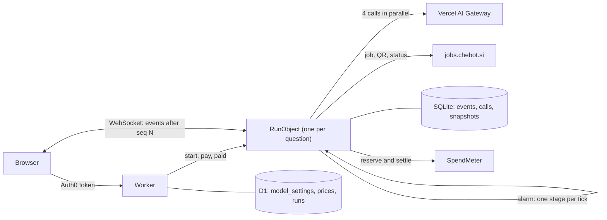

# Four AIs answer one question together

Today this repository is empty: one `main` branch, no commits, no code. When this plan is done, a signed-in user asks a question, pays for it by QR, and gets one answer that four models wrote together: what they agreed on, what stayed disputed and by whom, and a light view of how they got there. A run takes a bounded number of model calls (at most 17 to the four models), a bounded time and a bounded spend, because code decides every turn and the models only fill structured slots.

The work is ordered so that the cheapest question is answered first: **does the protocol produce better answers than the best single model?** Phase 1 answers it with a script, before any server or screen exists.

> [!WARNING]
> `https://che.bot` already serves another app: the fact-checking panel in `C:\Code\grokeado` (repository `devlooped/verificado`, Next.js on Vercel). This plan cannot take that hostname without a decision; see "Open questions". Until then the new app deploys to its own Workers hostname.

## What is reused from the existing app

The review asked to bring over how the models are configured "like in `C:\Code\chebot`". That folder is the desktop and WhatsApp app and has none of it; the code meant is in `C:\Code\grokeado`. From there this plan ports:

| What | Where it lives there | What it does |
| --- | --- | --- |
| Model roles and defaults | `src/court/models.ts` | Each seat is a role with a default model and effort |
| Settings | table `model_settings` in `src/store.ts` | An admin overrides a role; a missing row means the default |
| Version-less models | `src/lib/model-families.ts`, `src/court/model-config.ts` | A setting names a family; the newest model of the family in the Gateway catalog is used |
| Snapshot | `configuredModels` in `src/workflows/court-session.ts` | The resolved models are stored once when the session opens; every turn and every replay uses them |
| Gateway calls | `src/court/research.ts`, `evals/tiers/submission.ts` | AI SDK through Vercel AI Gateway, `Output.object`, `gateway.tools.parallelSearch` |
| Sign-in | `src/lib/auth0.ts` | Auth0, with roles in a claim |

The orchestration is not reused: that app runs on Vercel Workflow and Postgres, and this one runs on a Durable Object, as decided.

## What changes

### The run: a state machine, not a conversation

The orchestrator is a pure function: given the state of a run and the results of the last calls, it returns the next calls to make. It decides who speaks, about what, and when the run stops. Consensus means "no open suggestions", not unanimity: "3 of 4 agree, Grok dissents because…" is a valid ending.



| Stage | Calls | What happens |
| --- | --- | --- |
| Drafting | 4, parallel | Each model answers alone: answer, key claims with a confidence, sources. No model sees another. |
| Merging | 1, cheap model | The four drafts become the seeded document: paragraphs with stable IDs, each `agreed`, `majority` or `contested`. |
| Round 1 | 4, parallel | Propose only. |
| Round 2 | 4, parallel | Vote on round 1 suggestions, and propose on paragraphs that are not locked. |
| Round 3 | 4, parallel | Vote only. |
| Editing | 1 | One model smooths wording and fixes inconsistencies left by accepted changes. No change of substance. Skipped when no suggestion was accepted. |

Suggestions that are still open at the end stay on the answer as dissent notes in the margin.

### The rules of suggestions

These are the decisions made with the user; the code enforces them, the prompts only explain them.

- **Suggestions only, never edits.** A suggestion is a paragraph ID, an operation (`replace`, `insert_after`, `delete`), the new text and a one-sentence reason. Substance only (wrong, missing or misleading content); at most 3 per model in round 1 and 2 in round 2.
- **Frozen snapshot per round.** All four models work in parallel against the same version. Only the orchestrator changes the text, once, at the round boundary, in one deterministic pass.
- **IDs, not positions.** Suggestions target paragraph IDs, so accepted changes never shift each other and a suggestion made against an older version stays valid.
- **One open thread per paragraph.** A paragraph with an open thread is locked for new suggestions; models vote in the thread or add an alternative to it.
- **Collisions.** The same change proposed twice is merged by a cheap model and the second author counts as a vote in favor. Different changes to one paragraph become alternatives in one thread, and the next round chooses A, B or keep. Two insertions after the same paragraph are separate threads, ordered by the fixed model order (Grok, Claude, OpenAI, Gemini).
- **Voting.** Every model holds one position per thread: an alternative, or keep. An author starts on their own alternative. An alternative is accepted when at least 2 models other than its author hold it and they are a majority of the other models that voted. If two alternatives qualify, neither is applied.
- **No second attempt.** A rejected suggestion cannot be proposed again; the duplicate check also compares new suggestions with the rejected list.
- **Against herding.** Drafts are independent. In rounds, other models' positions are shown as "Reviewer A/B/C" (labels shuffled per thread), and a vote that differs from the voter's previous position must carry a reason.
- **Stopping.** The round cap above; a round with no new suggestion and no changed position ends the rounds; a per-question budget and a wall-clock deadline send the run to the editor pass with what exists; a model that times out abstains and a quorum of 3 continues (with fewer than 3 drafts the run merges what arrived, skips the rounds and says so on the answer).

### The data model

One package, `packages/protocol`, holds the types, the schemas and the reducer. It does no I/O, so the same code runs in the phase 1 script, in the Durable Object and (for the view) in the browser.

```ts
// packages/protocol/src/model.ts
export const MODELS = ["grok", "claude", "openai", "gemini"] as const; // fixed order: tie-breaks
export type ModelId = (typeof MODELS)[number];

export interface Paragraph {
  kind: "paragraph";
  id: string;                 // "p3": stable for the whole run, never reused
  text: string;
  support: ModelId[];         // whose draft claims this paragraph carries
  status: "agreed" | "majority" | "contested"; // derived from support, not chosen by a model
  sources: string[];          // Source ids
}
export type Block = Paragraph | Chart;          // Chart: phase 4, see "Charts"

export interface Snapshot { version: number; order: string[]; blocks: Record<string, Block> }

export interface Suggestion {
  id: string; thread: string;
  author: ModelId; coAuthors: ModelId[];        // coAuthors come from merged duplicates
  round: 1 | 2; baseVersion: number;
  target: { block: string; layer?: ChartLayer; path?: string };
  op: "replace" | "insert_after" | "delete" | "patch"; // "patch" is for chart layers
  text: string; reason: string; sources: string[];
}
export interface Thread {
  id: string;
  lockKey: string;            // "p3", "p3+grok" for an insertion, "c1/encoding" for a chart layer
  alternatives: string[];     // suggestion ids; "keep" is always a choice
  state: "open" | "accepted" | "rejected" | "unresolved";
  winner?: string;
}
export interface Vote {
  thread: string; voter: ModelId; round: 2 | 3;
  choice: string;             // a suggestion id, or "keep"
  reason: string;             // required when the position changed
}
export interface Source { id: string; url: string; title: string; quote: string; foundBy: ModelId }
```

The merge model does not decide what is contested. Each draft returns numbered claims; the merge returns paragraphs that list the claims they carry and the pairs of claims that conflict. The orchestrator checks that no claim was dropped and derives the status: 4 supporters is `agreed`, 3 is `majority`, fewer or a conflict is `contested`.

**Events** are the only thing the UI reads. They are appended to a log with a sequence number and an idempotency key:

```jsonc
{ "seq": 3,  "type": "payment.requested", "amount": 5000, "currency": "ARS", "qr": "000201…" }
{ "seq": 14, "type": "suggestion.opened", "batch": 2, "thread": "t3", "model": "grok", "block": "p4",
  "summary": "La cifra de 2019 no incluye las emisiones de alcance 3" }
{ "seq": 19, "type": "vote.cast", "batch": 3, "thread": "t3", "model": "claude", "choice": "s5", "changed": true,
  "reason": "El informe citado define la cifra sin alcance 3" }
{ "seq": 22, "type": "thread.accepted", "batch": 3, "thread": "t3", "tally": "3 de 4" }
{ "seq": 24, "type": "moment", "batch": 3,
  "text": "Grok marcó que la cifra de 2019 dejaba afuera el alcance 3. Claude cambió de opinión después de revisar el informe." }
```

The full list: `run.quoted`, `payment.requested`, `payment.confirmed`, `run.expired`, `run.started` (with the model snapshot), `stage.changed`, `model.status` (thinking, done, abstained), `draft.completed`, `document.seeded`, `suggestion.opened`, `suggestion.merged`, `vote.cast`, `thread.accepted`, `thread.rejected`, `thread.unresolved`, `snapshot.created`, `moment`, `run.completed`, `run.failed`. Threads, suggestions and votes are a reduction of this log.

### Models: roles, version-less settings, a snapshot per run

Every model the app calls is a role with a default, as in the existing app. The panel uses the flagship of each provider.

```ts
// packages/providers/src/roles.ts: defaults; an admin overrides them from the settings page
export const MODEL_ROLES = [
  { key: "panel.grok",   kind: "language", defaultId: "spacexai/grok-4.7",         defaultEffort: "medium" },
  { key: "panel.claude", kind: "language", defaultId: "anthropic/claude-opus-5.5", defaultEffort: "medium" },
  { key: "panel.openai", kind: "language", defaultId: "openai/gpt-6.1-sol",        defaultEffort: "medium" },
  { key: "panel.gemini", kind: "language", defaultId: "google/gemini-4-argon",     defaultEffort: "medium" },
  { key: "utility",      kind: "language", defaultId: "anthropic/claude-haiku-5.5", defaultEffort: null }, // merge, duplicates, moments, editor check
  { key: "classifier",   kind: "decision", defaultId: "typesafe-ai/jev",           defaultEffort: null },
] as const;
```

- **Settings are version-less.** A stored setting names a family, not a version. `modelFamily("anthropic/claude-opus-5.5")` is `anthropic/opus`; when a run starts, the newest model of that family in the Gateway catalog is chosen. A new model version needs no change of settings.
- **One snapshot per run.** The first step of a run resolves every role and stores the concrete IDs and efforts with the run. Every stage, every retry and every replay uses that snapshot; a change of settings in the middle of a run has no effect on it. The snapshot is shown with the answer ("who sat where").

```jsonc
// D1 table model_settings(role, model_id, effort, updated_at, updated_by): families only
{ "role": "panel.claude", "model_id": "anthropic/opus", "effort": "medium" }

// stored in the run and carried by run.started: concrete models
{ "panel.grok":   { "id": "spacexai/grok-4.7",         "effort": "medium" },
  "panel.claude": { "id": "anthropic/claude-opus-5.5", "effort": "medium" },
  "utility":      { "id": "anthropic/claude-haiku-5.5", "effort": null } }
```

The port keeps the family and newest-version rules as they are, and adds the `decision` kind, which the catalog reader of the existing app filters out.

### The provider interface: one adapter over Vercel AI Gateway

All model calls go through the AI SDK and Vercel AI Gateway, so there is one adapter and a scripted fake for tests (`packages/providers`), not four native adapters.

```ts
export interface ModelProvider {
  generate<T>(req: {
    callKey: string;            // "draft:0:grok": the idempotency key of the call
    model: { id: string; effort: string | null };   // from the run snapshot
    system: string; prompt: string;
    schema: z.ZodType<T>;
    maxOutputTokens: number;
    search?: { maxResults: number };
    signal: AbortSignal;        // the per-call timeout
  }): Promise<{
    output: T; sources: Source[];
    usage: { inputTokens: number; outputTokens: number };
    costUsd: number; latencyMs: number;
  }>;
}
```

```ts
// packages/providers/src/gateway.ts: the shape of a call
const result = await generateText({
  model: gateway(req.model.id),
  providerOptions: effortOptions(req.model),          // per provider, as courtModel() does today
  system: req.system, prompt: req.prompt,
  output: Output.object({ schema: req.schema }),
  tools: req.search ? { web_search: gateway.tools.parallelSearch({ maxResults: req.search.maxResults }) } : undefined,
  maxOutputTokens: req.maxOutputTokens, maxRetries: 0, abortSignal: req.signal,
});
```

How the guarantees are enforced:

- **Structured outputs.** Schemas are written once in Zod and kept simple: every field required, string enums, plain arrays; no optional or nullable fields, no numeric or length limits, no recursion. Every response is parsed again locally. Limits a schema cannot express (3 suggestions, one sentence) are enforced by the orchestrator: extra suggestions are cut in order, over-long ones dropped. An invalid response or a refusal is an abstention, not a retry.
- **Search with a schema.** The same Gateway search tool serves the four models, so sources have one shape. If a model does not return the object after using the tool, the adapter falls back to a `submit` tool that carries the schema, the pattern of `evals/tiers/submission.ts`, with tool choice left on automatic because some flagships reject a forced tool.
- **Timeouts.** Each call gets an `AbortSignal` with the stage timeout. The SDK's own retries are off, because they multiply the wall-clock; the adapter retries once on a 429 or 5xx inside the same timeout. A timeout is an abstention.
- **Budgets.** `costUsd` is the cost the Gateway reports for the call, so there is no price table to maintain. Before each stage the orchestrator compares what is spent plus the worst case of the stage with the budget of the question; if it does not fit, the run goes to the editor pass, or straight to done.
- **Sources.** A URL counts as a source only if it appears in the search results of that call. A URL the model typed without finding it is dropped. Search is on for drafts and off in rounds, where a suggestion cites sources the run already collected.

```ts
// packages/providers/src/limits.ts: starting values, tuned with the phase 1 measurements
export const limits = {
  callTimeoutMs: { draft: 90_000, round: 45_000, editor: 60_000, utility: 20_000 },
  deadlineMs: { quick: 120_000, thorough: 240_000 },   // quick: drafts and merge only, the evaluation's arm Q
  searchResultsPerDraft: 10,
};
```

### Classification and payment: two prices, one process, paid by QR

Asking needs a signed-in user. A question is first classified by a decision model through the Gateway as simple or complex. The class sets the price and nothing else: 5,000 ARS for a simple question, 10,000 ARS for a complex one. Every question then runs the same process, the full protocol above. The user pays before any panel model is called.

```ts
// apps/web/src/worker/quote.ts
const { answers } = await decide({
  model: gateway.decisionModel(models.classifier.id),
  state: { question },
  questions: {
    complexity: {
      type: "choice",
      instructions: "How much work does a reliable answer to this question need?",
      criteria: {
        simple: "one fact or definition that can be answered directly, with nothing disputable",
        complex: "needs sources compared, several steps of reasoning, or has disputable points",
      },
    },
  },
});
// answers.complexity → { type: "choice", choice: "complex", probabilities: { simple: 0.12, complex: 0.88 } }
```

- A choice with a probability under 0.7 counts as `complex`.
- The user sees the class and its price before paying. There is no mode to choose: the quick/thorough toggle of the design is gone from the product, because the class now sets the spend. Running without the rounds stays in the protocol as an option of the evaluation.
- The two amounts are defaults in the `prices` table, which an admin can change.
- Payment uses the CheBot jobs service (`https://jobs.chebot.si`, the `chebot-job` skill). The run ID is the job ID, a UUID. The app enqueues a job with the amount in ARS and an automation hook that points back to the app; the service returns a Mercado Pago QR; when the payment is processed it calls the hook, and the run starts.



A job that is not paid in 15 minutes is cancelled with `DELETE /jobs/:id` and the run expires. A run that fails after payment marks the job `failed` and lets the owner run the same question again without paying. A user with the `admin` role runs without paying, which is also how the app is tested before launch.

### The runtime: one Durable Object per question, driven by its own alarms



**The Durable Object drives the stages itself; Cloudflare Workflows is not used.** The reasons:

- A stage is one fan-out of at most 4 requests that ends within 90 seconds. An alarm handler may run 15 minutes of wall-clock, waiting on the network does not count as CPU time, and 6 outgoing connections may be open at once. One stage fits in one alarm with room to spare.
- The Durable Object must own the document, the event log and the browser connections anyway. With Workflows the state of a run would live in two places and every step would be a call back into the object.
- "A finished call is never repeated" needs a ledger in either design. Workflows retries a failed step 5 times by default, which is the opposite of the abstain rule, so its retries would be turned off and its main benefit unused.
- A run has at most 6 stages and lasts minutes. Workflows earns its cost on runs that last days or wait for outside events.
- The orchestrator is a pure function and the driver is about a hundred lines. If runs later need to outlive those limits, the driver can be replaced by a Workflow without touching the protocol.

```ts
// apps/web/src/worker/run-object.ts: the shape of the driver
export class RunObject extends DurableObject<Env> {
  async quote(input: QuoteInput) { /* insert the run row once, store the class and its price, append run.quoted */ }
  async pay()                    { /* enqueue the job once, setAlarm(now) to wait for the QR */ }
  async paid()                   { /* append payment.confirmed once, snapshot the models, setAlarm(now) */ }

  async alarm() {
    const state = this.loadState();
    const step = nextStep(state, Date.now());          // pure, from packages/protocol
    if (step.kind === "done") return;
    const results = await this.runCalls(step.calls);   // ledger: reuse finished calls, run the rest in parallel
    this.commit(reduce(state, step, results));         // one transaction: events, snapshot, state
    this.broadcast();                                  // to the connected browsers
    await this.ctx.storage.setAlarm(Date.now());       // next stage
  }
}
```

```sql
-- SQLite inside each RunObject
CREATE TABLE events    (seq INTEGER PRIMARY KEY, key TEXT UNIQUE, batch INTEGER, type TEXT, at INTEGER, data TEXT);
CREATE TABLE calls     (key TEXT PRIMARY KEY, status TEXT, started_at INTEGER, finished_at INTEGER,
                        output TEXT, usage TEXT, cost_usd REAL);
CREATE TABLE snapshots (version INTEGER PRIMARY KEY, doc TEXT, seq INTEGER);
CREATE TABLE run       (id TEXT PRIMARY KEY, owner TEXT, question TEXT, class TEXT, state TEXT,
                        models TEXT, amount REAL, currency TEXT, hook_token TEXT, budget_usd REAL, deadline_at INTEGER);

-- D1, shared by all runs
CREATE TABLE model_settings (role TEXT PRIMARY KEY, model_id TEXT NOT NULL, effort TEXT, updated_at TEXT NOT NULL, updated_by TEXT NOT NULL);
CREATE TABLE prices         (class TEXT PRIMARY KEY, amount REAL NOT NULL, currency TEXT NOT NULL); -- simple 5000 ARS, complex 10000 ARS
CREATE TABLE runs           (id TEXT PRIMARY KEY, owner TEXT NOT NULL, created_at TEXT NOT NULL, question TEXT NOT NULL,
                             class TEXT, status TEXT NOT NULL, amount REAL);
```

- **Start does not wait.** Each `POST` returns at once; the run goes on without any open HTTP request.
- **No double spend.** A row in `calls` is written before the request and updated when the result lands, each call on its own. Alarms are delivered at least once and retried up to 6 times, so a tick first reads the ledger: a finished call is reused, a call interrupted by a restart is retried once if the deadline allows, a call that timed out or returned invalid output stays an abstention. `events.key` is unique, so appending twice is a no-op. The job is enqueued once: a second `pay` or a repeated payment hook changes nothing.
- **Resume.** The browser connects with the last sequence number it saw and receives everything after it, then live events. A closed tab or a dropped connection loses nothing, including the QR. A finished run is read over plain HTTP.
- **Snapshots are stored, not passed around.** Events carry a version number; the document is fetched by version.
- **Runs are kept until deleted.** A run is readable by anyone who has its link. Its owner, or an admin, deletes it, which empties the object's storage and removes the row in `runs`.

```
POST   /api/runs                     {question}  →  201 { runId, class, amount, currency }  signed in
POST   /api/runs/:id/pay                         →  202                                   owner
POST   /api/pay/hook                             ←  jobs.chebot.si, Bearer run token
GET    /api/runs/:id                             →  { status, stage, version, lastSeq }   public by link
GET    /api/runs/:id/events?after=42             →  events after 42                       public by link
GET    /api/runs/:id/ws?after=42                 →  WebSocket: replay after 42, then live public by link
GET    /api/runs/:id/snapshots/:v                →  the document at version v             public by link
DELETE /api/runs/:id                                                                      owner or admin
GET    /api/me/runs                              →  the user's questions                  signed in
GET, PUT /api/admin/models, /api/admin/prices                                             admin
```

**Sign-in** is Auth0: the React app signs in with the Auth0 SPA SDK and sends an access token; the Worker verifies it against the tenant's keys and reads the roles claim (`admin`, `beta`). Until launch, asking is limited to the `admin` and `beta` roles, as the existing app does during its beta. The app is one Worker that serves the API, the Durable Objects and the built single-page app as static assets.

### The glimpse: three layers over the event stream, in Spanish

The interface is in rioplatense Spanish (voseo) by default; all text lives in one messages file (`es-AR`), so another language is a second file. The models answer in the language of the question, and the moments are written in the language of the interface. Code, identifiers and event types stay in English.

The UI never shows raw transcripts. It renders the events:

- **Ambient.** Four avatars with a status chip each, and one stage line: "Comparando respuestas… 2 puntos en discusión".
- **Moments.** A short feed of plain one-liners. One cheap-model call per round boundary turns that batch of events into at most 3 sentences; fixed templates are the fallback when the call fails or the budget is spent.
- **Document.** Clean text by default. Contested passages carry a margin mark and a "3 de 4" badge; a click opens the thread with the suggestion, the reasons and the votes; unresolved suggestions show as dissent notes. A history slider replays how the answer formed, from the stored snapshots.

A round arrives as one batch, so the browser plays the events of a batch about 400 ms apart, capped at 4 seconds, for the feel of live editing. Replays and catch-up after a reconnect render at once. The browser builds its view with the same reducer the server uses.

### Charts: a block with layers, data settled by source

A chart is a block in the document like a paragraph, split into layers that take suggestions and locks separately:

```ts
export interface Chart {
  kind: "chart"; id: string;
  brief: { question: string; measures: string[]; dimensions: string[] };
  data: { origin: "user" | "web"; rows: Row[] };  // Row: { key, values, source, alternatives[] }
  transform: unknown[]; encoding: object; mark: string; title: string; caption: string;
}
export type ChartLayer = "data" | "transform" | "encoding" | "title" | "caption";
```

- **Data rows are settled by source, never by vote.** Every row carries a source. With data from the user, the models only agree on the transform and the orchestrator computes the numbers; no model types a value. With data from the web, each value needs a citation; a conflict is settled by which source holds up, and if none does the chart shows both, drawn as a range.
- **Transform, encoding, title and caption** are settled by majority, with one open thread per layer, or per row for data.
- **Data first, design second.** The independent drafts are chart briefs (the question the chart answers, measures, dimensions, sources). The models agree on the brief and the dataset; then one model writes the Vega-Lite spec and the rounds run on transform, encoding and caption.
- **Checks.** The orchestrator compiles and renders every suggested patch before it reaches a vote; a patch that does not render is dropped. The theme (colors, fonts) is fixed in the app and stripped from suggestions. Optionally the last round votes on the rendered image.

The Workers runtime forbids generating code from strings, which Vega does by default. Vega's interpreter mode (`vega-interpreter`, with `ast: true`) avoids it; the first step of the chart phase proves that it runs inside a Worker within the 1 second startup limit.

### Repository layout

```
package.json               pnpm workspace, TypeScript strict, vitest
packages/protocol/         types, schemas, reducer, apply, prompts: no I/O
packages/providers/        ModelProvider over AI Gateway, fake provider, roles, families, catalog
apps/cli/                  headless runner and evaluation (Node)
apps/web/                  Worker, RunObject, SpendMeter, D1 migrations, React app (Vite)
eval/questions.jsonl       the question set
eval/results/              reports (raw outputs ignored by git)
```

## Steps

### Phase 0: scaffold

- [x] 1. Create the pnpm workspace with `packages/protocol`, `packages/providers`, `apps/cli`: TypeScript strict, vitest, lint, a `.gitignore` that covers `.env`, `.wrangler`, `node_modules` and `eval/results/raw/`, and a `README.md` with the product statement and the build order.

Verified when:

- [x] `pnpm install`, `pnpm -r typecheck` and `pnpm -r test` pass on a clean clone.

### Phase 1: the protocol as a headless script, and its evaluation

- [x] 2. Write the types in `packages/protocol/src/model.ts` and the Zod schemas of the four model outputs (draft, merge, round, editor) in `schemas.ts`, with a test that each schema stays inside the simple subset.
- [x] 3. Write `ModelProvider` and a scripted fake provider in `packages/providers` that returns canned outputs, delays, timeouts and invalid responses.
- [x] 4. Port the model configuration from `C:\Code\grokeado` into `packages/providers`: `roles.ts` (the six roles), `families.ts` (`modelFamily`, `latestModel`, with its tests), `catalog.ts` (the Gateway catalog reader with its cache, keeping the `decision` kind), and `resolveModels(settings, catalog)` that returns the snapshot of a run.
- [x] 5. Write the Gateway adapter in `packages/providers/src/gateway.ts` (AI SDK 7, `AI_GATEWAY_API_KEY`), with a live contract test per panel model that is skipped without the key: schema round trip, abort on timeout, the cost reported by the Gateway, sources from the search tool, and whether the object comes back after a search or the `submit` fallback is needed.
- [x] 6. Write the reducer in `packages/protocol/src/reducer.ts`: `nextStep(state, now)` and `reduce(state, step, results)` for drafting, merging (with the claim coverage check and the derived status), the three rounds and the editor pass.
- [x] 7. Write the suggestion engine in `packages/protocol/src/threads.ts`: lock keys, threads with alternatives, merged duplicates, the rejected list, the voting rule, and `apply(snapshot, acceptedThreads)` as one deterministic pass.
- [x] 8. Write the stopping rules: caps per round, early stop, budget, deadline, abstention with a quorum of 3, quick mode.
- [x] 9. Write the prompts per stage in `packages/protocol/src/prompts/`, in English, with the rule to answer in the language of the question: independence in drafts, substance only, anonymized positions, a reason for a changed position, and the editor's "no change of substance" with its check by the utility model (a rewrite that changes a claim is dropped).
- [x] 10. Write the classifier in `packages/providers/src/classify.ts` with `decide()` and the `classifier` role: the class, its probability, and the 0.7 rule.
- [x] 11. Write the local driver and `pnpm cli ask "<question>" --max-usd 1` in `apps/cli` (the full process by default; `--mode quick` stops after the merge, for the evaluation): it resolves and records the model snapshot, classifies the question, runs the protocol in Node, writes the event log as JSON lines, and prints the answer, the dissent notes, the moments and the cost.
- [x] 12. Write the moments: templates per event type in Spanish, and the utility-model phrasing per batch.
- [x] 13. Write `eval/questions.jsonl`: 50 questions, most of them in Spanish, with a category, a hand-set class (simple or complex) and a gold answer or a rubric (see "The evaluation").
- [x] 14. Write `pnpm cli eval --set eval/questions.jsonl --max-usd <n>`: it runs the arms, keeps every call result on disk so that a rerun never pays twice, runs the blind judging, produces the blind grading sheet of 20 answer pairs for the user, and writes `eval/results/<date>/report.md`.
- [ ] 15. Run the evaluation; the user grades the blind sheet; read the report together and record the decision to go on, to go on without the rounds, or to stop.

Verified when:

- [x] Unit tests cover each collision rule, the voting rule (including an abstention and two qualifying alternatives), locks, the rejected list, each stopping rule and the claim coverage check.
- [x] A property test shows that the same accepted suggestions give the same snapshot whatever order the model responses arrived in.
- [x] Tests show that a setting with an old version resolves to the newest model of its family, and that a run uses its snapshot after the settings change.
- [x] A fake-provider run goes through all stages, and replaying its event log rebuilds the same final document.
- [x] `pnpm cli ask` against the four live models returns an answer inside the deadline and under `--max-usd`, with every model call present once in the log.
- [x] `eval/results/<date>/report.md` exists and reports every metric of "The evaluation", with the user's grades included.

### Phase 2: the Durable Object runtime, sign-in, payment and the event stream

Starts only after step 15 says go.

- [ ] 16. Scaffold `apps/web`: Worker, `wrangler.jsonc` with the `RunObject` and `SpendMeter` SQLite classes and the D1 database, the Cloudflare Vite plugin, and the secrets `AI_GATEWAY_API_KEY`, `JOBS_URL`, `JOBS_TOKEN`, `AUTH0_DOMAIN`, `AUTH0_AUDIENCE`.
- [ ] 17. Write the D1 migrations (`model_settings`, `prices`, `runs`) and the settings access: read the settings and the catalog, resolve the snapshot.
- [ ] 18. Write the Auth0 check in the Worker: verify the access token against the tenant's keys, read the roles claim, and guard each route as listed in the API.
- [ ] 19. Write `RunObject` storage: the four tables, `quote()`, `pay()` and `paid()` that are each safe to call twice, and the idempotent event append.
- [ ] 20. Write the quote: classify with the decision model, read the price of the class, store both with the run, answer the `POST`.
- [ ] 21. Write the payment: enqueue the job with the automation hook and a per-run token, wait for the QR on alarm ticks, emit `payment.requested`, handle `POST /api/pay/hook`, expire and cancel an unpaid job after 15 minutes, and mark the job `done` or `failed` at the end of the run. Admin runs skip the job.
- [ ] 22. Write the alarm driver with the call ledger: one stage per tick, results stored as each call lands, the retry and abstain rules, `run.failed` after repeated handler errors, and the free rerun of a paid run that failed.
- [ ] 23. Write the read API and the WebSocket endpoint with the Hibernation API, with replay from a sequence number; write `GET /api/me/runs` and `DELETE /api/runs/:id`.
- [ ] 24. Write the guardrails: `SpendMeter` (one object, a daily cap in USD, reserve at start and settle at the end, runs refused when the cap is reached), the rate limiting binding on `POST /api/runs`, a length limit on the question, and the `admin` or `beta` role required to ask until launch.
- [ ] 25. Write the admin API for model settings and prices, with the family names offered from the catalog.
- [ ] 26. Deploy to a preview hostname and run one paid question end to end with a small real amount.

Verified when:

- [ ] Tests in the Workers runtime (`@cloudflare/vitest-pool-workers`, fake providers, a fake jobs service) show: no panel call is made before `paid()`; a second alarm for the same stage repeats no finished call; a restart in the middle of a round loses no finished call; a repeated hook or a second `pay` enqueues nothing.
- [ ] A client that disconnects and reconnects with `after=<seq>` receives every event once, in order, including the QR.
- [ ] A model that times out produces `model.status: abstained` and the run completes with three models; an exhausted budget sends the run to the editor pass; an unpaid run expires and its job is cancelled.
- [ ] A request without a valid token cannot ask, pay or delete; a run is readable by its link without signing in; a deleted run answers 404.
- [ ] A change of `model_settings` during a run does not change the models of that run.
- [ ] A paid run on the preview deployment against the live models completes with the browser tab closed, and its job ends as `done`.

### Phase 3: the UI on the event stream

- [ ] 27. Write the event client in `apps/web/src/app/`: connect, resume, the shared view reducer, the staggered playback of a batch, and the `es-AR` messages file.
- [ ] 28. Build sign-in with Auth0 and the ask page: the question box, the class and its price, and the QR with its amount and its waiting state.
- [ ] 29. Build the ambient layer: four avatars, status chips, the stage line.
- [ ] 30. Build the moments feed.
- [ ] 31. Build the document view: margin marks, the "3 de 4" badge, the thread popover with reasons and votes, dissent notes, sources, and the models of the run.
- [ ] 32. Build the history slider over the stored snapshots.
- [ ] 33. Build "Mis preguntas": the list of the user's runs, the share link, and delete with confirmation.
- [ ] 34. Build the admin page for the model of each role and the two prices.
- [ ] 35. Finish the states around the happy path: abstained model, failed run with its free rerun, expired payment, budget reached, reload in the middle of a run, small screens, keyboard and screen reader use.

Verified when:

- [ ] Playwright tests against `wrangler dev` with fake providers and a fake jobs service show: sign in, ask, see the price, pay, and reach a finished answer; a click on a margin mark opens its thread; the slider shows an earlier version; a reload while waiting for payment shows the same QR; a shared link opens signed out.
- [ ] Every visible text comes from the `es-AR` messages file, and a native reader finds no neutral or peninsular Spanish in it.
- [ ] One paid question on the preview deployment against the live models reads well to the user: no raw transcript, no technical term, the disagreement is clear.

### Phase 4: charts

Starts when prose works end to end.

- [ ] 36. Spike: compile a Vega-Lite spec and render it to SVG in interpreter mode inside the Workers runtime; measure the bundle and the startup time; decide whether the check runs in `RunObject` or in a separate Worker.
- [ ] 37. Add the `Chart` block: layers, lock keys per layer and per row, the `patch` operation on a path, and the theme stripped from suggestions.
- [ ] 38. Add the chart path to the reducer: chart briefs as drafts, agreement on the brief and the dataset, one model writes the spec, rounds on transform, encoding and caption.
- [ ] 39. Add the data rules: an uploaded CSV whose transform the orchestrator computes; web rows that need a citation; a conflict kept as two values with their sources.
- [ ] 40. Add the render gate: every patch is compiled and rendered before it reaches a vote.
- [ ] 41. Build the chart view: `vega-embed`, animation between snapshots, a note with the source on a corrected point, a range on a point whose value is disputed.
- [ ] 42. Optional: the last round votes on the rendered image (PNG rendering and image input in `ModelProvider`).

Verified when:

- [ ] Tests show that no value in a chart from user data was produced by a model: every number equals the orchestrator's computation over the uploaded rows.
- [ ] A patch that fails to compile or render never appears in a vote, and a patch that touches the theme is stripped.
- [ ] Ten chart questions run end to end, and each web-sourced row opens its citation.

## Findings and deviations during execution

- **Cost of a call (step 5).** On this Gateway account xAI and Google run on the user's own provider keys (BYOK), and for them the Gateway's `cost` holds only the search fee. The adapter counts the larger of `cost` and `marketCost` per step, so the budget does not see Grok and Gemini as free.
- **Search and the object (step 5).** In the live contract tests the four panel models returned the object after a search; the `submit` fallback was never needed. It stays in the adapter.
- **Decision models (steps 4 and 10).** The Gateway catalog lists them with the type `evaluation`, which the catalog reader maps to the `decision` kind. The `classifier` default `typesafe-ai/jev` resolves to `typesafe-ai/jev-1.14.0`. The other five defaults are in the catalog as written.
- **Sources (step 3).** `ModelProvider` returns the search results a call cited as `{ url, title, quote }`; the protocol assigns the source IDs and `foundBy`.
- **Snapshots in events (step 6).** `document.seeded` and `snapshot.created` carry the full document, so the event log alone rebuilds every version, as the replay test requires. This replaces "events carry a version number"; phase 2 still stores snapshots by version, and may send only the version over the WebSocket.
- **The rejected list (step 7).** It cannot apply inside a run: threads are rejected only after the votes of round 2, and round 3 takes no new suggestions. It is in the engine and tested there.
- **Round 2 on a locked paragraph (step 7).** A suggestion on a paragraph with an open thread joins that thread as an alternative, as the collision rule says.
- **Early stop and round 3 (step 8).** A round 2 with no new suggestion and no changed position ends the rounds even if threads are open; they end unresolved, as dissent notes.
- **Merge (step 6).** A merge that drops claims gets them back as their own contested paragraphs; a merge that fails is replaced by a document built by code from the claims. There is no retry. The merge call has its own timeout of 60 s. With one draft missing no paragraph can be `agreed`: three supporters is `majority`.
- **Voting details (step 7).** A co-author counts as a vote in favor. A model that abstains keeps its last position; one that never took a position is not counted. "Keep" rejects a thread with at least 2 holders that are a majority of the positions held.
- **Limits (step 11).** There is no `packages/providers/src/limits.ts`: the limits are the run configuration in `packages/protocol/src/config.ts`, because the reducer reads them and cannot depend on the providers. The values were tuned on live runs: larger output caps (reasoning tokens count against them), and an editor timeout of 35 s.
- **The deadline is hard (step 11).** No call outlives the deadline of the run, and the editor pass runs only if it and its check fit before it; accepted changes are applied either way. This replaces "the deadline sends the run to the editor pass": the first live run ended at 241.7 s against 240 s.
- **Grok's effort (step 11).** The default effort of `panel.grok` is `low`. At `medium`, grok-4.7 reasoned past 180 s on a round and timed out; at `low` it took 34 s. An admin setting can change it back.
- **Live timings (step 11).** A full run took 168 to 182 s and cost US$0.35 to 0.66; the drafts take up to 88 s (Gemini with search) and the merge about 30 s. The bar of 180 s at the 95th percentile is at risk; the evaluation measures it.
- **Line endings.** A `.gitattributes` keeps LF in every checkout, because Biome rejects the CRLF files that `core.autocrlf` produces on Windows.

## Results of the evaluation (step 15, run on 2026-11-16)

The evaluation ran on the 50 questions for US$19.28; the report is `eval/results/2026-11-16/report.md`. The user graded the 20 blind pairs of the plan; step 15 stays open until the user decides. The sheet (`eval/results/2026-11-16/grading-sheet.md`, choices in `grades.txt`) then got 20 more pairs, of T against the best single model, at the user's request.

| Check | Measured | Bar | Result |
| --- | --- | --- | --- |
| Runs that finish without an invalid output stopping them | 50 of 50 | 95% | pass |
| Wall-clock of the full protocol, 95th percentile | 177.8 s | under 180 s | pass, by 2 s |
| Correct answers, Q against the best single model (Claude) | 26 against 27, of 28 | Q no fewer | fail |
| Blind pairs Q won or tied against the best single model, judges | 32% (16 of 50) | 60% | fail |
| The same, by the user | 20% (2 of 10) | 60% | fail |
| Contested questions whose substance the rounds changed | 63% (29 of 46) | 30% | pass |
| Improvements against regressions | 26 against 2 | 2 to 1 | pass |
| Cost of T over cost of Q | 1.75 times | at most 2.5 | pass |
| Classifier agrees with the hand-set class | 76% (38 of 50) | 85% | fail |

- **Q loses to one model, T does not.** The merged document is worse than Claude's draft alone, and the rounds repair it: T beats Q in 32 of the 37 pairs where they differ. T and Claude alone have the same mean quality (4.62 of 5) and the same number of correct answers (27 of 28).
- **T against the best single model** is not a criterion of this plan, so it was measured as an extra: by the majority of the judges T wins 18, ties 17 and loses 15 of 50. The full protocol is level with the best single model, not clearly better. Its median question costs US$0.22 and takes 103 s, against US$0.04 and 17 s for Claude alone.
- **The classifier** agrees on 38 of 50; without the 0.7 rule it agrees on 40. It errs both ways: recent facts and misconceptions classed complex, false premises and multi-step problems classed simple.
- **Cost per class** (classifier, full protocol, mean): simple US$0.14, complex US$0.30; the 95th percentile is US$0.51. Both prices leave a wide margin.
- **Herding** is low: of 61 changed votes, 4 only deferred. Dissent notes were right 5 times and wrong 4 (6 unclear).
- **Editor choice** makes no difference: the finals differ on 9 runs and the judges tie all 9.
- **The user's grades** agree with the judges: Q won or tied 2 of 10 pairs against the best single model, and T won or tied 9 of 10 against Q.
- **The user's sheet** only grows: pairs 21 to 40 compare T with the best single model, on questions the user had not seen in pairs 1 to 20. They are an extra measure, outside the criteria, and are not graded yet.

## The evaluation of phase 1, and the criteria to go on

Published results on multi-agent debate are mixed, and much of the gain may come from independent drafts plus aggregation. The evaluation is built to separate those two effects, and to check the classifier that sets the price.

**Questions (50):** 12 stable facts with a checkable answer, 8 recent facts that need search, 8 multi-step or quantitative problems with a known answer, 8 contested questions (graded on whether the positions and the disagreement are shown fairly), 8 practical how-to questions, 6 with a false premise or an ambiguity. Each carries a hand-set class, simple or complex.

**Arms**, all from the same four drafts so that the comparison costs nothing extra:

| Arm | What it is |
| --- | --- |
| S1 to S4 | Each model's draft alone |
| Q | Drafts plus merge, without the rounds |
| T | The full protocol: what every paid question runs |

**Measures:**

- Correctness on the 28 questions with a known answer, judged blind against the gold answer.
- Blind pairwise preference, Q against the best single model and T against Q, by the four models as judges with shuffled, unlabelled answers, and by the user on the sheet of 20 pairs.
- How often the rounds changed the substance of the answer, and whether each change improved or worsened it.
- Cost and wall-clock per question, median and 95th percentile, per arm and per class; invalid outputs, timeouts and abstentions per model.
- The classifier: agreement with the hand-set class, and the cost of a run for each class.
- Signs of herding: positions that changed without a new argument; how often the dissent notes were right.
- Editor choice: the same runs finished with a rotating editor and with the model closest to the majority.

**Criteria**, with the best single model meaning the one with the best average, chosen after the fact:

| Check | Bar | If it fails |
| --- | --- | --- |
| The protocol is sound | 95% of runs finish without an invalid output stopping them; the full protocol under 180 s at the 95th percentile | Fix before judging anything else |
| Collaboration beats one model | Q has no fewer correct answers than the best single model, and wins or ties 60% of blind pairs against it, by the judges and by the user | Stop. The premise does not hold with this protocol; rethink before building a runtime |
| The rounds earn their cost | The rounds changed substance in 30% of questions that had contested paragraphs, improvements outnumber regressions 2 to 1, and T costs at most 2.5 times Q | Build phases 2 and 3 without the rounds; the two prices stay. The suggestion threads then have little to show, so the glimpse is redesigned around the differences between drafts |
| The classifier can set the price | It agrees with the hand-set class on 85% of questions | Charge one price until the criteria of the classifier are rewritten and measured again |

Fifty questions only show large effects. A borderline result means extending the set to about 150 before deciding, not rounding up. The whole evaluation is about 1,000 model calls plus judging; the runner prints the real spend and stops at `--max-usd`. Its cost per class shows the margin that 5,000 and 10,000 ARS leave.

## Decisions

Made with the user before this plan, and treated as fixed: a fixed protocol run by code; a shared document with tracked suggestions; proposals in parallel and application serialized; the stopping rules; charts as layered blocks with data settled by source; the three-layer glimpse; Cloudflare with one Durable Object per question; the build order.

Made by the user in the review of this plan:

| Decision | Choice |
| --- | --- |
| Who may ask | Signed-in users, with Auth0 |
| Who pays | The user, per question: a decision model classes the question simple or complex, and the class sets only the price: 5,000 ARS simple, 10,000 ARS complex. The process is the same for both. For now the payment is a Mercado Pago QR through the CheBot jobs service; a credit balance comes later |
| Models | The flagship of each provider, through Vercel AI Gateway, configured as in the existing app: roles, version-less settings, a snapshot when the run starts |
| Grading | The user grades about 20 blind answer pairs in phase 1 |
| Privacy | Runs are shareable by link and kept until deleted |
| Language | Spanish by default, rioplatense |

Made in this plan:

| Decision | Choice | Why |
| --- | --- | --- |
| Who drives the stages | The Durable Object, with alarms | One stage fits in one alarm; one owner of the state; Workflows' retries work against the abstain rule |
| Language of the code | TypeScript everywhere | The phase 1 protocol is the same code the Durable Object and the browser run, and the model configuration ports as it is |
| Agents SDK or plain Durable Object | Plain `DurableObject` | The state is an append-only log resumed by sequence number, not a synced state object |
| Quick or thorough for the user | No choice: every question runs the full process; running without the rounds stays as an option of the evaluation | The class sets the spend now, so the toggle of the design has nothing left to choose |
| An unsure classification | Under 0.7 counts as complex | An unclear question is charged as complex; phase 1 measures how often that happens |
| How payment is confirmed | The automation hook of the jobs service calls the app | No polling after the QR is shown; the service calls only after the payment is processed |
| A paid run that fails | The job is marked failed and the owner reruns the same question free | The jobs service has no refund call |
| Where settings live | D1 for settings, prices and the list of runs; SQLite in each Durable Object for the run | Settings are shared by all runs; a run stays self-contained and deletable |
| Who marks a paragraph contested | The orchestrator, from claim support | Takes the judgment away from the single merge model |
| Voting rule | 2 of the other models and a majority of those who voted | The user's rule, extended to alternatives and abstentions |
| Interrupted call | Retried once; a timeout or invalid output is not | Finished calls are never repeated, and the deadline holds |
| Editor | The model whose draft claims are most in `agreed` and `majority` paragraphs, ties by rotation | Fewest rewrites of others' content; phase 1 compares it with pure rotation |
| Search | The Gateway search tool, in drafts only | One source shape for the four models; bounds time and spend |
| Moments | One utility call per batch, templates as fallback | Plain language without a call per event |
| Front end | React and Vite, served by the same Worker, Auth0 SPA SDK | One deployment; the Worker only verifies tokens |
| Access before launch | The `admin` and `beta` roles, plus a global daily spend cap | Same gate as the existing app's beta; the cap bounds a mistake |

## Open questions

These are the user's to decide. None blocks phases 0 and 1.

> **Open:** Where does the new app live? `che.bot` serves the existing fact-checking app on Vercel. The choices are a subdomain for one of the two, a path of `che.bot` routed to the Worker, or the new app replacing the old one. Needed before step 26 gets a public hostname.

> **Open:** What does a user get when a paid run fails? The plan gives a free rerun of the same question; a refund through Mercado Pago would need a call the jobs service does not have. Needed before launch.

> **Open:** Which Auth0 tenant and roles? The plan assumes the tenant of the existing app with a new application and API, and its `admin` and `beta` roles. Needed before step 18.

> **Open:** Is a credit balance wanted soon? The plan charges per question by QR and leaves a prepaid balance out; it would add a ledger per user and a top-up flow.

## Risks

- **Four models agreeing is not being right.** Search in drafts and tracked sources reduce it; the evaluation measures correctness against known answers, not agreement.
- **Sycophantic convergence.** Independent drafts, anonymized positions and a reason for every changed position; the evaluation counts changes of position without a new argument.
- **Merge and editor bias.** The status of a paragraph is derived by code, no claim may be dropped by the merge, the editor's rewrites are checked for changed claims, and the editor choice is compared with rotation.
- **Invented numbers in charts.** No model types a value from user data, and web values need a citation found by search.
- **The price is set before the cost is known.** Both classes run the same process, so a question charged as simple can cost as much as a complex one. The budget per question caps the cost, phase 1 measures the cost per class against the two prices, and the daily cap bounds the total.
- **A payment confirmed while the run cannot start.** The hook is idempotent and the payment is recorded before any model call; a run that then fails gives the free rerun.
- **One gateway in front of every model.** An outage of Vercel AI Gateway stops all four. The provider interface keeps a native adapter possible, and a failed run costs the user nothing.
- **A new model version changes behavior without a change of settings.** That is the point of version-less settings; the snapshot records which model answered, and the evaluation can be rerun when a family moves.
- **A deploy or an eviction in the middle of a round.** There is no shutdown hook; in-flight calls are lost. Each result is stored as it lands and an interrupted call is retried once, so the loss is at most the unfinished calls of one round.
- **Reasoning tokens.** Several flagships cannot turn reasoning off and bill for it, so the output cap does not bound the cost alone. Effort is a setting per role and the budget uses the cost the Gateway reports.
- **Content from the web steering a model.** Models only fill slots and never write to the document, and sources are shown; a poisoned page can at most produce a suggestion that the others vote on.
- **Permanent, public-by-link runs hold what users typed.** The owner can delete a run, and the ask page says that the link is public.

## Out of scope

- A prepaid credit balance, refunds in money, invoices, and currencies other than ARS.
- Follow-up questions in the same run, and users commenting on or voting in threads.
- Streaming a model's text token by token: the batch model makes it unnecessary.
- More or other models than the four, and a model picker for users (the admin sets the models).
- A public gallery of runs, and link previews for shared runs.
- Changes to the existing app in `C:\Code\grokeado`, or sharing its database.

<details><summary>Limits and APIs checked on 2026-11-16</summary>

| Fact | Value | Source |
| --- | --- | --- |
| Alarm handler wall-clock | 15 minutes | [Workers limits](https://developers.cloudflare.com/workers/platform/limits/), [Durable Objects limits](https://developers.cloudflare.com/durable-objects/platform/limits/) |
| CPU per request, message or alarm | 30 s by default, up to 5 min with `limits.cpu_ms`; waiting on I/O does not count | Durable Objects limits |
| Outgoing connections open at once | 6 | Durable Objects limits |
| Alarms | One per object; delivered at least once; up to 6 retries with exponential backoff from 2 s; `alarmInfo.retryCount` | [Alarms](https://developers.cloudflare.com/durable-objects/api/alarms/) |
| SQLite storage | 10 GB per object on the paid plan; 8 MB per row or string; `ctx.storage.sql.exec`, `transactionSync` | Durable Objects limits, [SQLite storage API](https://developers.cloudflare.com/durable-objects/api/sqlite-storage-api/) |
| Lifetime | Pending I/O keeps the object in memory up to 15 min per operation; hibernation after 10 s idle; no shutdown hook, in-flight work is lost on a deploy | [Lifecycle](https://developers.cloudflare.com/durable-objects/concepts/durable-object-lifecycle/) |
| WebSockets | Hibernation API `ctx.acceptWebSocket`; attachment up to 16,384 bytes; received message up to 32 MiB | [WebSockets](https://developers.cloudflare.com/durable-objects/best-practices/websockets/) |
| Billing | Duration is billed while the object waits on a model call. A 3 minute run at 128 MB is about 23 GB-s; the 400,000 GB-s included per month cover about 17,000 such runs | [Durable Objects pricing](https://developers.cloudflare.com/durable-objects/platform/pricing/) |
| Workflows | Step result up to 1 MiB; default step retries 5 with 10 s exponential delay and a 10 minute timeout; steps billed since 2026-08-10 | [Workflows limits](https://developers.cloudflare.com/workflows/reference/limits/), [retries](https://developers.cloudflare.com/workflows/build/sleeping-and-retrying/), [pricing](https://developers.cloudflare.com/workflows/reference/pricing/) |
| Rate limiting binding | Periods of 10 or 60 s; counted per location and approximate, so it is a brake and not the spend cap | [Rate limiting](https://developers.cloudflare.com/workers/runtime-apis/bindings/rate-limit/) |
| Decision models | `experimental_decide` in `ai` 7.0.128 or later, `gateway.decisionModel(id)`, or `POST https://ai-gateway.vercel.sh/v1/decisions`; `choice` answers carry the choice and the probability of each option; billed per token | [AI Gateway: Decision](https://vercel.com/docs/ai-gateway/modalities/decision) |
| Jobs service | Job ID is a client UUID; `POST /jobs/{id}` with `amount` in ARS gives `pending` with `pay.qr`; the automation hook runs after the payment is processed; `PATCH` ends a job in `queued` or `running`; `DELETE` cancels in `created` or `pending` | `skills/chebot-job/SKILL.md` in `devlooped/chebot.si` |
| Vega without code generation | `vega.parse(spec, null, { ast: true })` and `expr: vega.expressionInterpreter`; about 10% slower | [Vega interpreter](https://vega.github.io/vega/usage/interpreter/) |

Left to a step, not confirmed from documentation: the exact `assets` keys of `wrangler.jsonc` for a single-page app (step 16); whether the object comes back after a Gateway search tool call on each panel model (step 5); that AI SDK 7 runs unchanged in the Workers runtime (step 16, with the adapter's contract test); which decision model classifies best (step 10 starts with the documentation's example).

</details>

<details><summary>Alternatives ruled out</summary>

- **Cloudflare Workflows as the driver.** See "The runtime". It stays the fallback if runs must outlive an alarm.
- **Building this inside the existing app.** It already has the seats, the settings, Auth0 and the Gateway, but it runs on Vercel Workflow and Postgres; the user chose a Durable Object per question, whose single-threaded ownership of the document is what the batch protocol relies on.
- **Four native provider SDKs.** The first version of this plan had them; the Gateway gives one adapter, one search tool, one cost figure and the catalog that version-less settings need.
- **Polling the jobs service for payment.** The automation hook tells the app at once and needs no open connection.
- **The Agents SDK (`agents`).** Its state sync broadcasts a state object, and its fibers do not retry on their own; the plain object with a ledger is smaller and exact.
- **Server-sent events instead of a WebSocket.** The Durable Object keeps WebSockets across hibernation for free; a plain HTTP read of events remains as the fallback.

</details>
