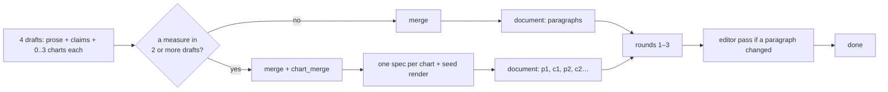

# Charts inside answers, chosen by the models

Today a chart is a separate kind of run. The user ticks "Quiero un gráfico" (or passes `--chart`), with data from the web or from an uploaded CSV, and the answer is the chart alone: no prose, no editor pass. A prose run can never show a chart, however much the question asks for one.

Once this work is done there is one kind of run and nothing to tick. Each model drafts its answer and, when charts help, the data for up to three of them, each value with a citation from that model's own web search. A chart that at least two drafts agree on goes into the answer, placed inside the prose. In the rounds each model suggests changes to paragraphs, patches any chart, checks the sources of disputed rows and votes, all in one call. The CSV upload is removed: every figure of a chart comes from a source found online.

## What changes

### One draft call, with up to three charts

The draft schema gains `charts`, an array of zero to three charts, in the shape of today's `brief_web`. The model fills it from the same search it makes for the prose, using its provider's built-in search tool, so no call is added. The prompt says when to include a chart: the answer compares figures across time, places or categories, and each figure can be cited from a search result. It says to leave one out for a conceptual answer or a single figure, and to use one chart per measure: two measures are two charts.

```ts
// packages/protocol/src/schemas.ts
export const draftSchema = z.object({
  answer: z.string(),
  claims: z.array(claimSchema),
  charts: z
    .array(chartBriefSchema) // question, dimension, measure, mark, rows[{key, value, source, quote}]
    .describe("Up to 3 charts, one per measure, when figures compared across time, places or categories make the answer clearer; [] otherwise."),
});
```

The kinds `brief_web` and `brief_user` disappear. `reduceBriefs` reads the `charts` of the `draft:0:<model>` outputs. A brief is identified by its draft label and its index (`B2` is the second chart of draft B).

### Who decides: the drafts, by majority, chart by chart

There is no decision before the run, and the classifier is not involved: it only prices the question. After the drafts, if at least 2 drafts include a chart, `chart_merge` (one utility call) groups the briefs by measure and aligns the row labels inside each group:

```ts
// chart_merge output, extended from today's
{
  charts: [
    { question, dimension, measure, briefs: ["A1", "C1", "D2"],   // briefs that measure this
      keys: [{ row: "A1.3", key: "2026-03" }, …] },               // one label per row, as today
    …
  ]
}
```

A group becomes a chart block (`c1`, `c2`, `c3`, in the order of their support) when briefs from at least 2 drafts are in it, at most 3 charts per answer. Groups with less support, and runs where no group qualifies, end in a new event, `chart.declined`, which records the proposed measures and why each was dropped, so the moments and the CLI can say so. Code still compares the values and opens the disputes per row, as today.

### Chart state per block

`RunState.chart` (one `ChartRunState`) becomes `RunState.charts`, a record keyed by block id: briefs, writer, base, seed, disputes, renders, dropped patches and reverts per chart. The constant `CHART_ID` goes away, and the code that reads it takes the block id. Lock keys already carry it: `c2/encoding`, `c2/data/<row>`.

### One document: paragraphs and charts

The merge stage runs the prose `merge` and `chart_merge` in the same step. Then each chart gets its own `spec` call, all in parallel, each from a writer chosen like the editor and rotating so that no model writes two specs. The spec output gains `after`, the id of the paragraph the chart illustrates best. One seed render renders every spec, as the renderer already takes several. The seeded document is the paragraphs with each chart after its paragraph, or after the first paragraph when `after` is unknown.



### One round call: suggestions, patches, checks, votes

`round1`, `round2` and `round3` absorb the chart rounds, and the `chart_round*` kinds go away. Each schema carries every field. A run without charts gets `patches: []` and `checks: []`, and the prompt says so. A patch and a check name their chart (`chart: "c2"`).

```ts
round1: { suggestions, patches, checks }
round2: { votes, suggestions, patches, checks }
round3: { votes, checks }
```

- **Caps:** paragraph suggestions and chart patches keep separate caps of 3 in round 1 and 2 in round 2. The patch cap covers all charts together. Checks of disputed rows are not capped. Each part is still read by its existing code: `readRound` for paragraphs and `readChartRound` for the charts.
- **Locks:** one open thread per paragraph, per layer of a chart, and per row of a chart, with the keys above. One list of votes covers every thread.
- **Order at the round boundary:** the render gate runs on the patches first (`pending.gate`), then the duplicate check on the paragraph suggestions, then one apply. This is the order `stepAt` already follows.
- **Prompt:** the round prompt shows the paragraphs with each chart in its place (data, status and sources of each row, layers) and adds the chart rules only when the document has a chart. Rows settled by their sources are marked, so a reviewer can fix a paragraph whose figure contradicts them.

A round cannot add a chart: it has no web search, and web values need citations. It cannot delete or move one either. A disagreement about a chart is voted on its layers.

### The editor pass with charts present

The end of the rounds settles the disputes and renders the last version first, which is today's `settle`. Then the prose rule applies: the editor runs if a paragraph suggestion was accepted. The editor sees the charts read-only (title, caption, settled rows) so that the wording matches them. It returns only paragraphs, and `editor_check` still compares only paragraphs. A change to a chart alone does not trigger the editor.

### The upload goes away

All data comes from web search, so the code for uploaded data is deleted:

- `ChartOrigin` `"user"`, the row status `"upload"`, `transform` agreed on columns, and the "no value from a model" checks of uploads;
- `csv.ts` and `parseCsv`, and the `brief_user` prompt;
- the file input on the ask page, the `--csv` option and `chartOf` in `quote.ts`;
- the `chart` column of the `run` table in `run-store.ts`.

The `transform` layer stays: models can still propose transforms over the web rows.

### Limits, price and classification

- **Price:** the price does not change. The ask page already says a chart costs the same, and the classifier stays as it is.
- **Budget:** `chart_merge`, the spec calls and the renders are cheap, and the budget check still stops a run before it overspends. `worstCaseUsd.draft` and `round*` rise to cover the chart fields (draft about 0.65, rounds about 0.4).
- **Deadline:** the spec calls run in parallel, so a thorough run with charts, every call at its full timeout, takes about 37 minutes: the prose run's 32 plus the spec, renders and moments. `deadlineMs.thorough` goes from 35 to 40 minutes.

### The interface and the CLI

- **Ask page:** `AskPage` loses the toggle, the "web or file" choice and the file input; only the question box remains. `POST /api/runs` takes `{ question }`.
- **Run page:** `RunPage` renders one document. `AnswerDocument` draws paragraphs, and at each chart block it draws the chart view of step 41: chart, table of rows with sources, notes and voted layers, with notes numbered per chart. The run's sources are listed once. The view finds the charts in the snapshot's blocks instead of reading `run.started.chart`, and the history slider moves every chart between versions.
- **Run summary:** `charts` on the summary becomes the number of charts, read from the last snapshot, for "Mis preguntas".
- **CLI:** `--chart` and `--csv` go away. `ask` prints the prose answer, then one chart report per chart, and writes `chart-<id>.vl.json`, `rows-<id>.json` and `chart-<id>-v<N>.svg` per chart.

## Steps

- [x] 1. Remove the upload: delete `csv.ts`, `briefUserPrompt`, the `"user"` origin and `"upload"` status, the upload paths in `chart-run.ts`, `chart.ts` and `answer.ts`, `userChart` in `chart-fixtures.ts` and their tests. Also remove `chartOf` and the CSV parsing in `quote.ts`, the `chart` column in `run-store.ts`, `--csv` in the CLI, and the file input in `AskPage`. Run the tests: the web chart and prose runs still pass.
- [x] 2. Chart state per block: replace `RunState.chart` with `RunState.charts` keyed by block id. Take the block id in every function of `chart-run.ts` that uses `CHART_ID`, and add `chart` to the patch and check schemas. A pure restructuring: the scripted web chart run gives the same events, apart from the new field. Files: `chart-run.ts`, `reducer.ts`, `schemas.ts`, `events.ts`, `replay.ts`, `answer.ts`.
- [x] 3. Protocol kinds: add `charts` to `draftSchema`, `after` to `chartSpecSchema`, the groups to `chartMergeSchema`, and `patches` and `checks` to `round1/2/3`. Remove `brief_web` and `chart_round1/2/3` from `CallKind`, `SCHEMAS`, `worstCaseUsd`, `maxOutputTokens` and the timeouts in `call()`. Add `chart.declined`. Files: `schemas.ts`, `config.ts`, `events.ts`, `reducer.ts`, `schemas.test.ts`.
- [x] 4. Drafts: change `draftPrompt` to propose up to three charts, saying when to and when not to. `briefCalls` disappears, and `reduceBriefs` reads the charts of each draft. Files: `prompts/draft.ts`, `prompts/chart.ts`, `chart-run.ts`, `reducer.ts`.
- [x] 5. The decision and the merge: run `merge` and `chart_merge` in one step. Turn the groups with 2 or more drafts into `c1..c3`, and emit `chart.declined` for the rest. Run one spec call per chart with rotating writers, one seed render for all of them, and seed the document with each chart after its `after` paragraph. Files: `reducer.ts`, `chart-run.ts`, `prompts/chart.ts`.
- [x] 6. Rounds: build one prompt that combines `roundPrompt` and `chartRoundPrompt` for any number of charts. `reduceRound` reads both parts of each output, with their own caps and drops. Keep the order gate, then dedupe, then apply. Files: `prompts/round.ts`, `prompts/chart.ts`, `reducer.ts`, `chart-run.ts`.
- [x] 7. Close and editor: `closeStep` settles the charts first, then decides on the editor by the prose rule. `editorPrompt` shows the charts read-only. Files: `reducer.ts`, `prompts/utility.ts`.
- [x] 8. Limits: raise the worst cases and the thorough deadline, and update the comment that sizes them. File: `config.ts`.
- [x] 9. Answer, replay and moments: `selectAnswer` covers the paragraphs and `selectChart(input, block, version?)` one chart. The replayed view takes the charts from the blocks, and `run.started` loses `chart`. Moments get the template for `chart.declined`, and `momentFacts` drops its run-wide `chart` flag. Files: `answer.ts`, `replay.ts`, `moments.ts`, `events.ts`.
- [x] 10. Fixtures and protocol tests: rewrite `webChart` in `chart-fixtures.ts` and `fixtures.ts` for the new call kinds. Add scripted runs where 1 draft proposes a chart (prose only), where 3 drafts propose the same measure (prose and one chart), where they propose two measures (two charts), and where they disagree (declined). Update `chart-run.test.ts` and `run.test.ts`, including the replay and any-order tests on a mixed document.
- [x] 11. Driver and CLI: update `packages/driver/src/chart-testing.ts`. In `apps/cli/src/ask.ts`, drop `--chart`, report the prose and every chart, and update `ask.test.ts` and `ask-chart.test.ts`.
- [x] 12. Worker: update `api.ts` (`POST /api/runs {question}`, and `/charts/:block/:v.svg` for the render of one chart), `run-object.ts` (the summary's count of charts) and the Workers tests `charts.test.ts` and `api.test.ts`.
- [x] 13. Web app: make `AnswerDocument` draw each chart block in place, reusing `ChartDocument`, and render one document in `RunPage`. Update `es-AR.ts` (remove `ask.chart.*`, and add the "no chart" note if one is shown), `view/chart.ts`, `view/derive.ts` and `History.tsx`.
- [x] 14. Local mode and e2e: update `src/local/chart-scenario.ts` and `scenario.ts` so that the scripted questions answer with prose and two charts, and with prose alone. Update `e2e/charts.spec.ts`, `a11y.spec.ts` and `run.spec.ts`.
- [x] 15. Docs: in `README.md` (the CLI examples, the local-mode table, the API), describe the new behavior. In `.alta/plans/2026-11-16-consensus-answers.md`, add a finding that points to this plan, since its findings "A chart run (steps 37 to 40)" and "Uploaded data (step 39)" are no longer true.

## Findings and deviations during execution

- **Chart state (step 2).** `RunState.charts` keeps what the charts share (the proposed briefs, the disputes, the renders, the dropped patches, the reverts and the dispute counter: dispute ids stay unique in the run) and `plans`, keyed by block id, for what each chart has of its own (its briefs, writer, base, place and seed).
- **Renders carried (steps 5 to 7).** A version that leaves a chart as it was (an accepted paragraph, the editor, a change to another chart) records the render of the version before for that chart, without a render call (`carryRenders`). Each render event is keyed by chart and version.
- **The close with charts (step 7).** What is still open is settled in a step of its own, which is a new batch of events and moments (a settle in the same batch repeated the key of its moments call), then the close runs again and decides on the editor by the paragraphs only.
- **Grouping without the utility model (step 5).** When `chart_merge` gives nothing, the briefs whose measure is written the same way form a group.
- **The web page (step 13).** The answer, the sources and the history are one each: the paragraphs and the charts in the order of the document, the sources the paragraphs cite and those of the rows, and one history slider whose steps show each chart in its place with what changed in it. `ChartDocument` exports `ChartBlock`; the rows the drawing computed (`drawn()`, `onDrawn`) served only the table of an upload and are gone, with the CSS of the ask options and of that table.
- **Stage line (step 13).** A finished answer with charts says the line of the text, then how the rows of its charts ended.
- **Live runs (verification).** "¿Por qué el cielo es azul?": prose, no chart proposed, US$0.21, 80 s. "¿Cuál fue la inflación mensual de Argentina en 2026?": prose and one chart, 10 months agreed by the four drafts, each row citing an INDEC report, US$0.72, 215 s. "¿Cómo evolucionaron la inflación y el desempleo en Argentina en 2025?": prose and two charts (12 months of inflation, 5 quarters of unemployment from the EPH), US$0.85, 226 s. In both runs with charts the utility model's moments of one or two round batches came back invalid and the templates were used. `--max-usd 2` no longer starts a run: the worst case of the four drafts is US$2.60.

## How it is verified

- [x] `pnpm -r typecheck` and `pnpm -r test` pass, including the Workers tests.
- [x] Protocol tests show that a chart is kept for a measure in 2 or more drafts, that two measures give two charts, that the cap is 3, and that a lone or disagreeing chart is declined (`chart.declined`).
- [x] A scripted mixed run accepts a paragraph suggestion and patches on two charts in the same round, runs the editor only because of the paragraph, and gives the same versions whatever order the outputs arrive in.
- [x] Replaying the event log alone rebuilds every version of a mixed document, renders of every chart included.
- [x] A grep finds no `parseCsv`, `brief_user`, `"upload"` or `--csv` left.
- [x] Playwright against the local mode: a question answers with prose and two charts in their places, their rows open their sources, a layer's discussion opens, and the history slider moves both charts; a conceptual question answers with prose and no chart; the ask page has no chart option.
- [x] Live through the CLI (about US$4): "¿Cuál fue la inflación mensual de Argentina en 2026?" gives prose and a chart; "¿Cómo evolucionaron la inflación y el desempleo en Argentina en 2025?" gives two charts; "¿Por qué el cielo es azul?" gives no chart. Record time and cost in the findings.

## Decisions

| Decision | Choice | Why |
| --- | --- | --- |
| Who decides there is a chart | The drafts: a measure in 2 or more drafts, grouped by `chart_merge` | Independent and in the same call as the prose; the classifier does not see sources |
| Where the data comes from | Always the models' own web search, each value with its citation; the CSV upload is removed | The user's choice in the review |
| How many charts | Up to 3 per answer, one per measure | Several charts, as answered in the review; the cap bounds the spec calls and the rounds' prompt |
| Where a chart goes | After the paragraph its spec writer names, else after the first | The writer sees the paragraphs; rounds do not move blocks |
| Charts in rounds | Patches, row checks and votes; no new chart, no delete, no move | Rounds have no search, and web values need citations |
| Caps | 3 and 2 for paragraphs, and the same separately for patches on all charts | Each part keeps its existing reading code and tests |
| Editor | Runs only when a paragraph was accepted; sees the charts read-only | A chart's text (title, caption) is voted on its layers |
| Price | No change | The ask page already says a chart costs the same; the budget bounds the spend |
| Old runs | No migration | Nothing is deployed yet (step 26 is open); old local runs may not open |

## Risks

- **Prose against the charts:** a paragraph can state a figure that differs from a row settled by its source. Limited by marking settled rows in the round prompt and by showing the charts to the editor; a disagreement that survives stays visible as dissent.
- **Grouping by measure:** `chart_merge` can split one measure in two groups, or join two. Code still requires 2 drafts per group, and the scripted tests cover a split; the live two-measure question checks it.
- **Too many or too few charts:** the models may add charts that add little, or leave one out. Requiring 2 drafts cuts single-model whims; the live check measures this on three questions.
- **Longer, heavier rounds:** with charts a round call carries more, and Grok already timed out in chart rounds. Its effort setting is the lever, as in the earlier plan.

## Out of scope

- Charts added, deleted or moved by a round.
- A vote on the rendered image (step 42 of the earlier plan).
- Any change to the price or to the classifier.